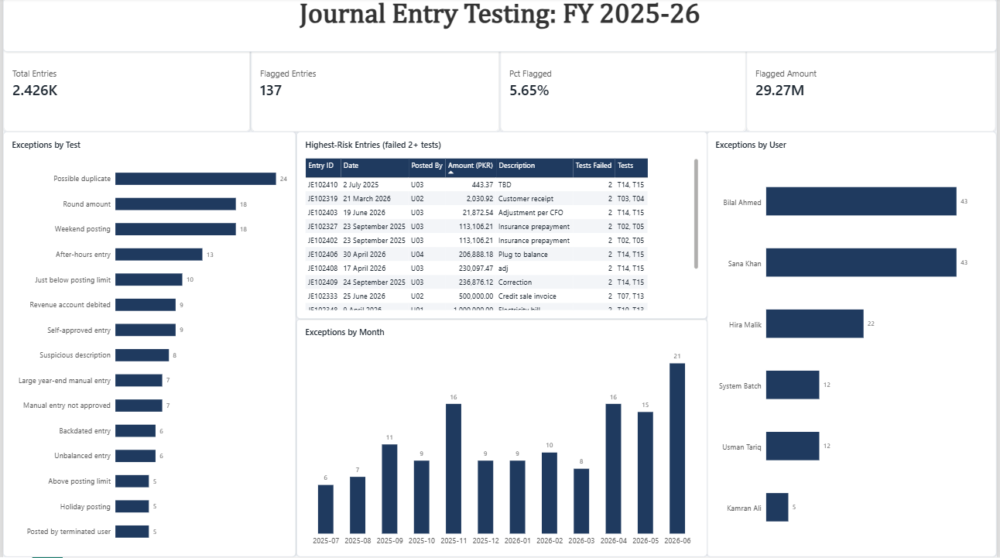
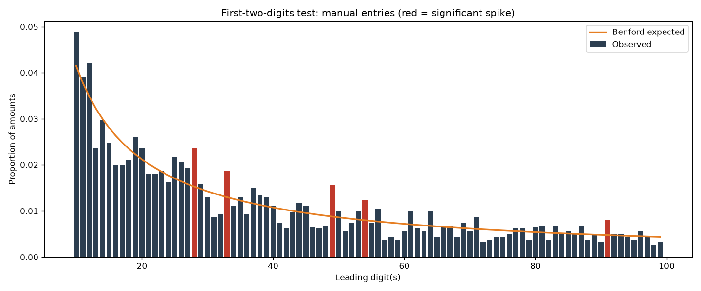

# Journal Entry Testing: Audit Data Analytics

Rule-based and statistical testing of a full year of general ledger journal entries, built with **PostgreSQL**, **Python**, and **Power BI**.

Journal entry testing is a standard audit procedure under **ISA 240** (the auditor's responsibilities relating to fraud). Because management can override controls by posting manipulated entries, auditors test 100% of journal entries against risk criteria instead of relying on random samples. This project builds that process end to end: load and validate the ledger, run 15 risk tests, corroborate results with Benford's Law, and present findings in a dashboard.



## Dataset

A **synthetic** general ledger for a fictional Pakistani company, covering FY 2025-26 (1 July 2025 to 30 June 2026). Real ledgers are confidential, so the data was generated with realistic patterns, planted control exceptions, and deliberate data quality problems.

| File | Contents |
|---|---|
| `journal_entries.csv` | 4,852 lines across 2,426 journal entries |
| `users.csv` | 7 users with roles, posting limits, and employment status |
| `chart_of_accounts.csv` | 20 accounts with account types |

## Approach

**1. Load (ELT).** Raw CSVs are loaded into PostgreSQL staging tables with every column as `TEXT`, so malformed rows are kept for inspection instead of failing the load.

**2. Profile and cleanse.** Profiling found three data quality issues, each of which would have caused exceptions to be missed:

| Issue | Rows | Impact if not fixed | Fix |
|---|---|---|---|
| Mixed date formats (`DD/MM/YYYY` vs `YYYY-MM-DD`) | 10 | Date-based tests skip these entries | Parsed each format explicitly |
| Lowercase user IDs (`u01` vs `U01`) | 15 | Silent join failures, so authorization tests miss these entries | `UPPER(TRIM())` |
| Padded, uppercase descriptions | 25 | Keyword searches miss these entries | `TRIM`, plus a lowercase matching key |

Cleaning was validated with record count reconciliation (4,852 = 4,852), referential integrity checks against users and accounts, and ledger control totals. The control totals showed the ledger **out of balance by PKR 15,038.55**, which was traced to specific entries in test T01.

**3. Test.** 15 tests in SQL, all writing to a single exceptions register (`je_exceptions`):

| Category | Tests |
|---|---|
| Integrity | T01 Unbalanced entry, T02 Possible duplicate |
| Timing | T03 Weekend posting, T04 Public holiday posting, T05 After-hours entry, T06 Backdated entry (>30 days), T07 Large manual entry in the last week of the year |
| Authorization | T08 Self-approved (segregation of duties), T09 Manual entry not approved, T10 Above posting limit, T11 Just below posting limit (95-100%), T12 Posted by terminated user |
| Content | T13 Round amount, T14 Suspicious description (e.g. "plug", "TBD", "override"), T15 Revenue account debited |

**4. Corroborate with Benford's Law (Python).** First-digit and first-two-digit tests using Nigrini's MAD conformity thresholds and z-statistics, with a drill-down into significant spikes.

**5. Report (Power BI).** Dashboard connected directly to PostgreSQL, with cross-filtering between tests, users, and months.

## Key findings

- **137 of 2,426 entries (5.6%) flagged**, totalling PKR 29.27M. A focused population for follow-up rather than a list too long to review.
- **3 year-end sales accruals** (PKR 1.15M to 1.89M) posted by the Finance Manager on the weekend of 27-28 June 2026, the last days of the financial year. Large manual revenue entries at period end are a classic earnings management risk.
- **5 entries** combine a vague description ("Plug to balance", "adj", "TBD", "Correction", "Adjustment per CFO") with a direct debit to revenue, all posted by senior staff.
- **10 entries between PKR 490,000 and 499,999**, just under the PKR 500,000 accountant approval limit. This was found independently by two methods: SQL test T11, and the Benford first-two-digit test, where "49" was the most significant spike (z = 4.01). The drill-down confirmed both point to the same 10 entries.
- **9 self-approved entries** by senior staff, **7 unapproved manual entries**, and **5 entries by a terminated user**, indicating weaknesses in access and approval controls.
- **6 unbalanced entries** fully explain the PKR 15,038.55 ledger difference.

Overall, the first-digit Benford test showed close conformity (MAD 0.0051): a small number of manipulated entries does not distort the ledger as a whole. This is why broad statistical tests are paired with targeted rule-based tests.

## Benford's Law: manual entries



Red bars are statistically significant spikes (z > 2.57). Only "49" was traced to a real pattern; the others (28, 33, 54, 91) are consistent with normal random variation, a reminder that statistical flags need investigation, not automatic conclusions.

## Project structure

```
je-testing/
├── data/raw/                         Source CSVs
├── sql/
│   ├── 01_load_and_explore.sql       Staging tables, load, data profiling
│   ├── 02_clean.sql                  Typed clean tables, fixes, validation checks
│   ├── 03_tests_integrity_timing.sql Tests T01-T07
│   └── 04_tests_authorization_content.sql  Tests T08-T15, risk ranking, CSV export
├── notebooks/benford.py              Benford's Law analysis
├── output/                           Exceptions register, risk ranking, charts
├── powerbi/                          Dashboard (.pbix) and theme
└── images/                           Dashboard screenshot
```

## How to run

1. Create a PostgreSQL database named `je_testing`.
2. From the project folder in `psql`, run the SQL files in order:
   ```
   \i sql/01_load_and_explore.sql
   \i sql/02_clean.sql
   \i sql/03_tests_integrity_timing.sql
   \i sql/04_tests_authorization_content.sql
   ```
3. Run the Benford analysis:
   ```
   pip install -r requirements.txt
   python notebooks/benford.py
   ```
4. Open `powerbi/je_dashboard.pbix` in Power BI Desktop and refresh.

## Notes and limitations

- Thresholds (30 days for backdating, PKR 500,000 for year-end entries, 95% of limit) are illustrative. In a real engagement they would be set from materiality and the client's control environment.
- T12 flags all entries by a terminated user. A real audit would compare posting dates to the HR termination date.
- The public holiday list covers FY 2025-26 only, and Eid dates depend on moon sighting.
